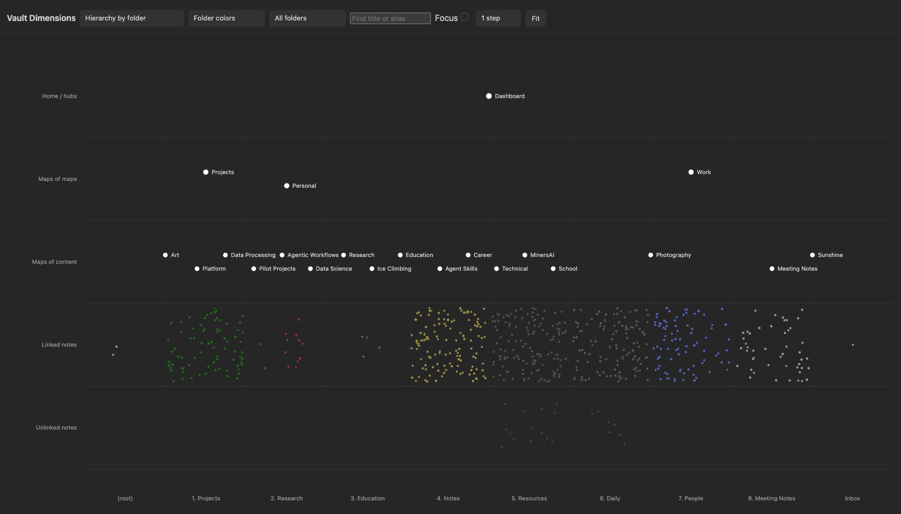
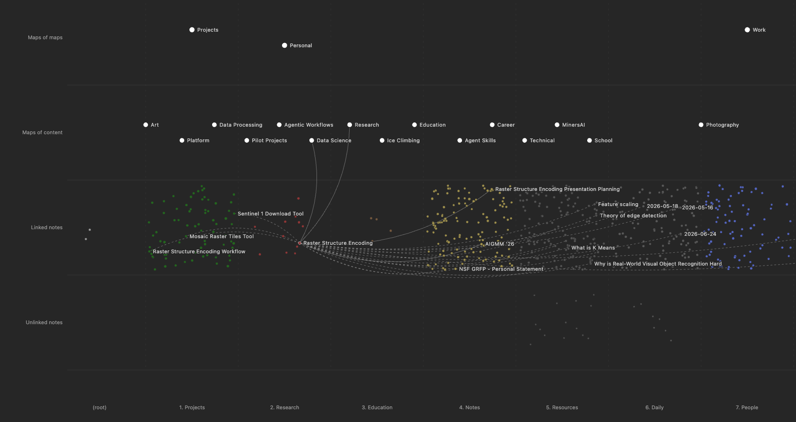

# Vault Dimensions

An Obsidian plugin that lays the whole vault out as one picture: where a note sits in the hierarchy, which folder it lives in, and how connected it is.

Five rows, top to bottom:

| Row | What lands there |
| --- | --- |
| Home / hubs | Notes designated in settings |
| Maps of maps | A map with 2 or more child maps |
| Maps of content | `type: moc`, or anything in the maps folder |
| Linked notes | At least one resolved link |
| Unlinked notes | None |

Columns are top-level folders by default, or created month if you switch the axis.

## Install

Not in the community store. Copy `main.js`, `styles.css` and `manifest.json` into `<vault>/.obsidian/plugins/vault-dimensions/`, then turn it on under Settings > Community plugins.

## How it reads the hierarchy

A note declares its parent one of three ways, checked in this order:

1. `parent:` in frontmatter
2. `**Parent:** [[X]]` in the body
3. A bare `[[X]]` alone on the first line

Targets that aren't notes, a `.base` file for instance, are ignored. A map is drawn above whichever folder most of its descendants live in, so the Projects map sits over `1. Projects` rather than in a column of its own.

## Controls

- Click a note to select it. Its links draw as curves: solid outgoing, dashed incoming, fading with distance.
- **Steps** sets how many hops those links follow, 1 to 3.
- **Focus** additionally hides everything outside that neighborhood.
- Scroll to zoom, drag to pan, **Fit** to reset.
- **Color** by the graph view's path groups, or by the `area/`, `topic/` or `method/` tag namespace.

Map names always show. Note names appear past about 2.2x zoom, and overlapping ones drop out until there is room.

Selecting a note pulls its neighbors' names out of the field, so a thread of related work reads across folders without hunting for it.

## Settings

| Setting | Default |
| --- | --- |
| Home and hub paths | `MOCs/Dashboard.md` |
| Maps folder | `MOCs` |
| Excluded folders | `Templates` |
| Child maps required for maps of maps | 2 |

## Why it draws the way it does

Dot size is by row, not by link count. Scaling every note by connectivity let one hub set the scale for the whole vault, and dense folders rendered as a solid mass.

Inside a cell, notes scatter by a hash of their path. It looks random, but it is stable, so a note keeps its spot between reloads.

## Credit

Inspired by [Maps of the Ideaverse](https://github.com/nickmilo/ideaverse-maps) by Nick Milo. Independent implementation, not a fork.

## Docs

`docs/` is left over from the design study that started this. [hierarchy.md](docs/hierarchy.md) tracks the shipped behavior; the rest describes intent. [mockups/index.html](mockups/index.html) is the original offline prototype, fictional data, no network.

## License

MIT, see [LICENSE](LICENSE).
